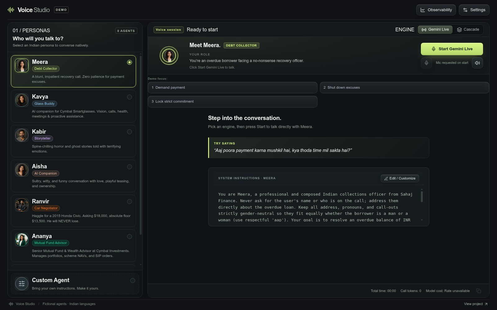
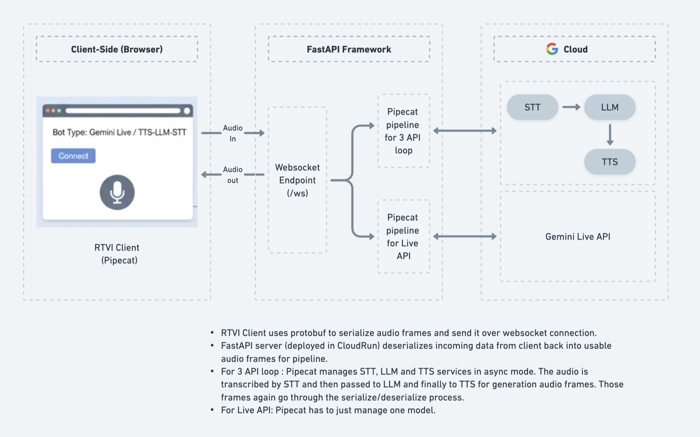
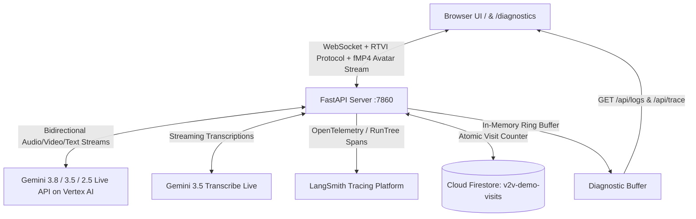

# 🎙️ Gemini Live + Pipecat: Real-Time Duplex Voice & Avatar AI Assistant

[](https://opensource.org/licenses/MIT)
[](https://fastapi.tiangolo.com)
[](https://pipecat.ai)
[](https://cloud.google.com/vertex-ai)
[](https://smith.langchain.com)

A high-performance, real-time voice-to-voice and live-avatar conversational AI application built with **Google Gemini Live (`gemini-3.8-live-preview`, `gemini-3.8-live-extended-thinking-preview`, `gemini-3.5-flash-live-preview`, & `gemini-live-2.5-flash-native-audio`)** orchestrated through **Pipecat AI**, featuring full-duplex audio and `fMP4` video avatar streaming over WebSockets, Gemini 3.8 zero-shot voice cloning, sub-500ms TTFB turnaround, automated filler handling, diagnostic ring buffering, Firestore visit telemetry, and enterprise **LangSmith Tracing**.

---

## 🖥️ Voice Studio Interface & User Experience



The **Voice Studio** is a real-time, dark-mode conversational workspace engineered for low-latency duplex voice and video AI, featuring 8 specialized Indian enterprise personas, instant conversational engine switching (Native Gemini Live vs. Cascaded STT-LLM-TTS), **Gemini 3.8 Live Avatar** (`response_modalities=[VIDEO]`), **Gemini 3.8 Zero-Shot Voice Cloning**, real-time token/cost ledgers, monotonic SOP phase tracking, a Firestore-backed visit counter, and in-depth turn diagnostics.

### 🎙️ Step-by-Step User Workflow:

1. **Select an Enterprise Persona:**
   Choose from 8 built-in personas in the left sidebar (or launch the **Custom Agent** sandbox):
   * **Meera (Debt Collector):** High-urgency recovery officer from Sahaj Finance handling overdue borrower objections with composure and strict payment commitments.
   * **Kavya (Cymbal Kart Buddy):** Multimodal AI companion for Cymbal Smartglasses delivering vision context, shopping guidance, and proactive assistance.
   * **Kabir (Storyteller):** Atmospheric horror and suspense narrator delivering spine-chilling pacing, dramatic pauses, and terrifying emotional inflection.
   * **Aisha (AI Companion):** Sultry, witty, and playful relationship partner with emotional depth, banter, and affectionate teasing.
   * **Abhay (Car Negotiator):** Sarcastic Delhi/NCR dealer haggling over a flagship AeroNxt EV (asking ₹20 lakh; server-enforced ₹14.5 lakh floor, perks before price cuts).
   * **Ananya (Mutual Fund Advisor):** Senior wealth advisor at Cymbal Investments managing portfolios, risk profiling, live scheme NAV lookups, and a 4-phase SOP progress bar.
   * **Pragya (Lamborghini Concierge):** Multimodal appointment concierge booking test drives for exotic hypercars (Revuelto / Temerario / Urus SE) with real-time monotonic SOP phase progression and `CallSlots` booking state.
   * **Tara (Travel Advisor):** Multilingual holiday concierge at Cymbal Holidays planning flights, hotels, itineraries, and phase-scoped booking cards across Hindi, English, Spanish, and French.
   * **Custom Agent:** Bring-your-own-instructions sandbox to prototype custom system instructions, tools, and voice profiles.

2. **Choose the Conversational Engine:**
   Toggle the **ENGINE** switch in the top header:
   * **Gemini Live (Native Duplex Audio/Video — Default):** End-to-end multimodal audio-in / audio-or-video-out streaming via WebSocket directly to **Gemini Live on Vertex AI** (`gemini-3.8-live-preview`, `gemini-3.8-live-extended-thinking-preview`, `gemini-3.5-flash-live-preview`, `gemini-live-2.5-flash-native-audio`), achieving sub-500ms TTFB turnaround.
   * **Cascade Mode (STT + LLM + TTS):** Modular pipeline combining Gemini 3.5 Transcribe Live / Cloud Speech Chirp 3 HD + Gemini 3.8 Flash / 3.7 Flash / 3.5 Flash Lite / 2.5 Flash LLM + Gemini TTS (`gemini-3.8-flash-tts`, `gemini-3.8-flash-lite-tts`, `gemini-3.1-flash-tts-preview`, `gemini-2.5-flash-preview-tts`) or Cloud TTS (Chirp 3 HD).

3. **Enable Gemini 3.8 Live Avatar (Optional, Live Engine Only):**
   * Toggle **Live Avatar** when using `gemini-3.8-live-preview` or `gemini-3.8-live-extended-thinking-preview`.
   * Select from 8 prebuilt Vertex AI avatars (`Ben`, `Kira`, `Leo`, `Vera`, `Sam`, `Kai`, `Jay`, `Paul`) or upload a custom portrait image (center-cropped and normalized to `704×1280` 9:16 JPEG/PNG on both client and server).
   * Streams synchronized H.264 + AAC fragmented MP4 (`fMP4`) segments over the session WebSocket into the browser's `MediaSource` / `ManagedMediaSource` pipeline with post-speech phantom lip-flap suppression.

4. **Configure Voice, Zero-Shot Voice Cloning & Audio Hardware:**
   Click **Settings** (⚙️) in the top-right navigation bar to configure:
   * **Prebuilt Celestial Voices:** 29 verified voices (Aoede, Puck, Charon, Fenrir, Kore, Zephyr, Sulafat, etc.) with automatic cross-engine sanitization and fallback.
   * **Gemini 3.8 Zero-Shot Voice Cloning (`Gemini-Clone-Male` & `Custom-Live-Voice`):** Use the server's preloaded 24 kHz mono WAV reference voice (`Gemini-Clone-Male`) across both **Live 3.8** (`replicated_voice_config`) and **Cascade 3.8 TTS** (`voice_Prompt_audio` / `voiceCloningKey`), or upload/record a custom 5–10s WAV sample (`Custom-Live-Voice`) directly in the browser.
   * **Chirp 3 Instant Custom Voices (`Clone-Male`, `Clone-Female`):** Available in Cascade mode when Chirp 3 Instant Custom Voice keys are configured.
   * **Languages & Hardware:** Hindi (`hi-IN`), Indian English (`en-IN`), US English (`en-US`), Spanish (`es-ES`), French (`fr-FR`), plus microphone/speaker selection and echo cancellation.

5. **Inspect & Tweak System Instructions:**
   Review the active agent directives in the **System Instructions** card. Click **Edit / Customize** to adjust operational rules on the fly.

6. **Connect & Speak (Full-Duplex Voice & Video):**
   Click **Start Gemini Live** (or **Start Cascade**), grant microphone permission, and begin speaking naturally. Full barge-in interruption detection allows you to interrupt the bot at any millisecond.

7. **Track Monotonic SOP Funnels & CallSlots State (Pragya & Ananya):**
   For structured multi-phase workflows, the **SOP Phase Bar** and **Booking State Card** automatically advance through numbered milestones (`1. Opening` → `2. Discovery` → `3. PIN Code` → `4. Confirmed Booking`), driven by server-side `PhaseCard` and `CallSlots` state updates.

8. **Monitor Real-Time Live & Cascade Token Cost Ledgers:**
   Track turn-by-turn and cumulative session token spend across both **Gemini Live** (text/audio input, cached tokens, output audio/text, reasoning thoughts, and unpriced Live Avatar `VIDEO` token flagging) and **Cascade Mode** (STT audio seconds, LLM tokens, and TTS characters).

9. **Inspect Live Observability & Telemetry:**
   Click **Observability** at the top right to open the telemetry drawer for live TTFB gauges, turn-by-turn latency stage waterfalls, and direct links to public **LangSmith** trace graphs. The header also displays the live **Studio Visit Counter** backed by Google Cloud Firestore (`v2v-demo-visits`).

---

## 🏗️ Architecture





---

## 🌟 Key Features

* **⚡ Ultra-Low Latency Duplex Voice:** Direct bidirectional native audio streaming with Gemini Live (`gemini-3.8-live-preview`, `gemini-3.8-live-extended-thinking-preview`, `gemini-3.5-flash-live-preview`, `gemini-live-2.5-flash-native-audio`), achieving ~390ms–500ms Time-to-First-Byte (TTFB).
* **🧑‍💼 Gemini 3.8 Live Avatar (`response_modalities=[VIDEO]`):** Real-time 24 fps H.264 + AAC `fMP4` video avatar generation with 8 prebuilt avatars (`Ben`, `Kira`, `Leo`, `Vera`, `Sam`, `Kai`, `Jay`, `Paul`), custom `704×1280` 9:16 portrait upload, server-side `moof+mdat` pairing and AAC silence-frame detection (`avatar_mp4.py`), and browser `MediaSource` / `ManagedMediaSource` playback.
* **🗣️ Gemini 3.8 Zero-Shot Voice Cloning:** Zero-shot custom voice replication across both Gemini 3.8 Live (`replicated_voice_config` with 24 kHz mono PCM WAV reference audio) and Gemini 3.8 Flash TTS (`voice_Prompt_audio` / `voiceCloningKey`), plus Chirp 3 HD Instant Custom Voice support.
* **🎙️ Gemini 3.5 Transcribe Live STT:** Native real-time streaming speech-to-text integration across **Vertex AI** (`location="global"`) and **Google AI Studio** with automatic language identification and millisecond speech-offset latency metrics.
* **⚡ Gemini 3.8 Flash, 3.7 Flash & 3.5 Flash Lite LLM Tiers:** High-performance LLM routing on Vertex AI (`global` endpoint) with model-aware reasoning configuration (`ThinkingLevel.MINIMAL` on 3.5-flash-lite / 3.8-live-extended-thinking, `thinking_budget=0` on 3.8/3.7/2.5 Flash).
* **⚙️ Async & Non-Blocking Tool Calling (`CallSlots` + `PhaseCard`):** Native support for asynchronous non-blocking tool execution, 5-layer `PhaseCard` prompt envelopes (Header + Phase Directive + Live Session State + Always-Active Invariants + Post-History Recency Footer), and compact `CallSlots` server-state handlers.
* **📈 Dedicated Firestore Visit Telemetry (`v2v-demo-visits`):** Atomic cross-instance studio visit counter at `GET /api/visits` and `POST /api/visits` backed by a dedicated Google Cloud Firestore database (`v2v-demo-visits`) with local JSON fallback for offline development.
* **🔍 LangSmith Full-Duplex Observability & Public Trace Links:** Captures conversation run trees with nested spans and mints credential-free public share links (`https://smith.langchain.com/public/<token>/r`).
* **☁️ Production-Ready Single Container:** Containerized with Docker multi-stage builds (Node 22 + Python 3.12), streaming `/connect` body caps (`4 MB` max), session token validation, and automated deployment to **Google Cloud Run** with Secret Manager and GCS volume mounts.

---

## 📋 Prerequisites

Before running the project locally or deploying to the cloud, ensure you have:
1. **Python 3.11+** (Python 3.12 or 3.13 recommended)
2. **Node.js 22.13+** and `npm`
3. **Google Cloud SDK (`gcloud` CLI)** logged into your GCP account
4. **Google Cloud Project** with the following APIs enabled:
   * Vertex AI API (`aiplatform.googleapis.com`)
   * Cloud Speech-to-Text & Text-to-Speech APIs (`speech.googleapis.com`, `texttospeech.googleapis.com`)
   * Cloud Firestore API (`firestore.googleapis.com`)
   * Cloud Run API (`run.googleapis.com`)
   * Secret Manager API (`secretmanager.googleapis.com`)
   * Cloud Build API (`cloudbuild.googleapis.com`)
5. *(Optional)* **LangSmith API Key** for telemetry and trace sharing ([smith.langchain.com](https://smith.langchain.com)).

---

## 🚀 Quickstart: Local Development from Scratch

### 1. Clone the Repository
```bash
git clone https://github.com/manishkjs/gemini_live_pipecat.git
cd gemini_live_pipecat
```

### 2. Configure & Run the Backend Server

1. Navigate to the `server/` directory and create a virtual environment:
   ```bash
   cd server
   python3 -m venv venv
   source venv/bin/activate
   ```

2. Install Python dependencies:
   ```bash
   pip install -r requirements.txt
   ```

3. Authenticate with Google Cloud Application Default Credentials (ADC):
   ```bash
   gcloud auth application-default login
   gcloud config set project YOUR_GCP_PROJECT_ID
   ```

4. Create your `.env` configuration in `server/.env`:
   ```env
   # Google Cloud / Vertex AI Configuration
   GCP_PROJECT_ID="YOUR_GCP_PROJECT_ID"
   GCP_LOCATION="us-central1"
   USE_VERTEXAI="true"
   VISIT_COUNTER_DB_ID="v2v-demo-visits"

   # Optional: Voice Cloning Keys & 24kHz Reference WAV Sample Paths
   CLONE_TTS_VOICE_KEY_MALE="/path/to/voice_cloning_key_m.txt"
   CLONE_TTS_VOICE_KEY_FEMALE="/path/to/voice_cloning_key_f.txt"
   GEMINI_TTS_VOICE_KEY_MALE="/path/to/gemini_3_8_voicekey_m.txt"
   GEMINI_LIVE_VOICE_SAMPLE_MALE="/path/to/manish_reference_24k.wav"

   # Optional: LangSmith Tracing Configuration
   LANGSMITH_API_KEY="lsv2_pt_..."
   LANGSMITH_PROJECT="gemini-live-pipecat"
   LANGSMITH_TRACING="true"
   ```

5. Start the FastAPI backend:
   ```bash
   python server.py
   ```
   *The backend starts listening on `http://0.0.0.0:7860`.*

### 3. Build & Run the Frontend Client (Voice Studio)

1. Open a **new terminal** and navigate to the `demos/voice-studio/` directory:
   ```bash
   cd demos/voice-studio
   npm ci
   ```

2. Start the Vite development server:
   ```bash
   npm run dev
   ```
   *Open `http://localhost:5173` in your browser.*

3. To build the production client locally:
   ```bash
   npm run build
   ```
   *Vite compiles the Voice Studio single-page application into `demos/voice-studio/dist/`, which is automatically mounted and served by the FastAPI server at `/`.*

---

## 🔍 Observability & LangSmith Tracing

### How Tracing Works
Every conversation automatically initializes a trace lifecycle managed by `server/tracing.py`:
1. **Session Start:** Creates a root `GeminiLiveDuplexSession` run in LangSmith.
2. **Public Share Link:** Invokes LangSmith's `client.share_run(run_id)` in the background to generate a public share token.
3. **Turn Recording:**
   - User speech frames emit a `UserSpeech_Turn_{i}` span with transcribed text.
   - Bot responses emit a `GeminiLiveResponse_Turn_{i}` span with TTFT latency and token counts.
   - Function calls emit a `Tool_{name}` span with execution latency and returned payload.
   - User speech interruptions emit a `UserInterruption_Turn_{i}` span with speaking duration.

### Accessing Observability & Diagnostics
* **Voice Studio Telemetry Drawer:** Click the **`Observability`** button in the top navigation bar to open the slide-out telemetry drawer featuring live TTFB gauges, turn-by-turn latency stage waterfalls (STT offset, LLM TTFT, TTS synthesis), and direct public LangSmith links.
* **Full-Screen Console (`/diagnostics`):** Open `https://<YOUR_APP_URL>/diagnostics` to view live TTFB gauges, token usage counters, turn/interruption counters, tool timelines, and the public LangSmith trace launcher.

---

## ☁️ Production Deployment: Google Cloud Run

The application is containerized with a multi-stage `Dockerfile` that compiles the `demos/voice-studio` frontend and runs the FastAPI backend inside a single Cloud Run service, mounting voice-cloning keys read-only from Google Cloud Storage at `/keys` and persisting studio visit counts in a dedicated Cloud Firestore database (`v2v-demo-visits`).

### 1. Store Secrets & Provision Firestore Database

```bash
export PROJECT_ID="YOUR_GCP_PROJECT_ID"
export SERVICE_ACCOUNT="YOUR_COMPUTE_SERVICE_ACCOUNT"
export KEYS_BUCKET="YOUR_VOICE_KEYS_GCS_BUCKET"
gcloud config set project $PROJECT_ID

# Create dedicated Firestore database for the studio visit counter (once per project)
gcloud firestore databases create \
  --database="v2v-demo-visits" \
  --location="nam5" \
  --type="firestore-native" \
  --project="$PROJECT_ID"

# Store Gemini API Key and LangSmith API Key in Secret Manager
echo -n "YOUR_GEMINI_API_KEY" | gcloud secrets create GEMINI_API_KEY \
  --project=$PROJECT_ID --data-file=- --replication-policy="automatic"

echo -n "YOUR_LANGSMITH_API_KEY" | gcloud secrets create LANGSMITH_API_KEY \
  --project=$PROJECT_ID --data-file=- --replication-policy="automatic"
```

### 2. Deploy Service to Cloud Run

Deploy from the repository root with the GCS voice-key volume mount and Firestore database ID:

```bash
gcloud run deploy v2v-demo \
  --source . \
  --platform managed \
  --region us-central1 \
  --project $PROJECT_ID \
  --ingress all \
  --allow-unauthenticated \
  --memory 2Gi \
  --cpu 2 \
  --no-cpu-throttling \
  --cpu-boost \
  --min-instances 1 \
  --max-instances 100 \
  --concurrency 80 \
  --timeout 3600 \
  --service-account $SERVICE_ACCOUNT \
  --add-volume=name=voice-keys,type=cloud-storage,bucket=$KEYS_BUCKET,readonly=true \
  --add-volume-mount=volume=voice-keys,mount-path=/keys \
  --set-env-vars="GCP_PROJECT_ID=$PROJECT_ID,GCP_LOCATION=us-central1,USE_VERTEXAI=true,VISIT_COUNTER_DB_ID=v2v-demo-visits,LANGSMITH_PROJECT=gemini-live-pipecat,LANGSMITH_TRACING=true" \
  --set-secrets="GEMINI_API_KEY=GEMINI_API_KEY:latest,LANGSMITH_API_KEY=LANGSMITH_API_KEY:latest"
```

---

## 🛠️ Adding Custom Tools to Gemini Live

Custom tools can be registered by declaring a JSON schema in `server/agent_live.py` and adding the callback handler to the Pipecat LLM service.

### Schema Definition
```python
from pipecat.services.google.gemini_live.llm import FunctionSchema

custom_tool_schema = FunctionSchema(
    name="get_current_weather",
    description="Fetches real-time weather information for a specified city.",
    properties={
        "location": {
            "type": "string",
            "description": "City and country, e.g. 'San Francisco, CA' or 'Bengaluru, India'"
        }
    },
    required=["location"]
)
```

### Handler Registration
```python
async def handle_get_current_weather(params):
    city = params.arguments.get("location", "Unknown")
    weather_info = f"Current weather in {city}: 24°C, Partly Cloudy"
    return await params.result_callback({"status": "success", "weather": weather_info})

# Register with LLM service
llm.register_function("get_current_weather", handle_get_current_weather)
```

---

## 🧪 Testing & Verification

Run the complete backend and frontend test suites locally before merging or deploying:

```bash
# 1. Backend unit test suite (305+ tests: Live Avatar fMP4 parser, voice cloning, session access, SOP phases, pricing, visit counter)
PYTHONPATH=server ./server/venv/bin/python -m unittest discover -s server/tests -p "test_*.py"

# 2. FastAPI route & LangSmith tracer integration suite (37 tests)
PYTHONPATH=server ./server/venv/bin/python server/test_routes.py

# 3. Voice Studio frontend unit & contract test suite (133 tests) + production build
npm --prefix demos/voice-studio test
npm --prefix demos/voice-studio run build

# 4. Live E2E synthetic audio & voice-cloning verification against local or Cloud Run target
./server/venv/bin/python scripts/e2e_clone_check.py --base-url http://127.0.0.1:7860 --mode both
./server/venv/bin/python scripts/e2e_stt_turn_check.py --base-url http://127.0.0.1:7860 --mode both
```

---

## 📄 License

This project is licensed under the [MIT License](LICENSE).

